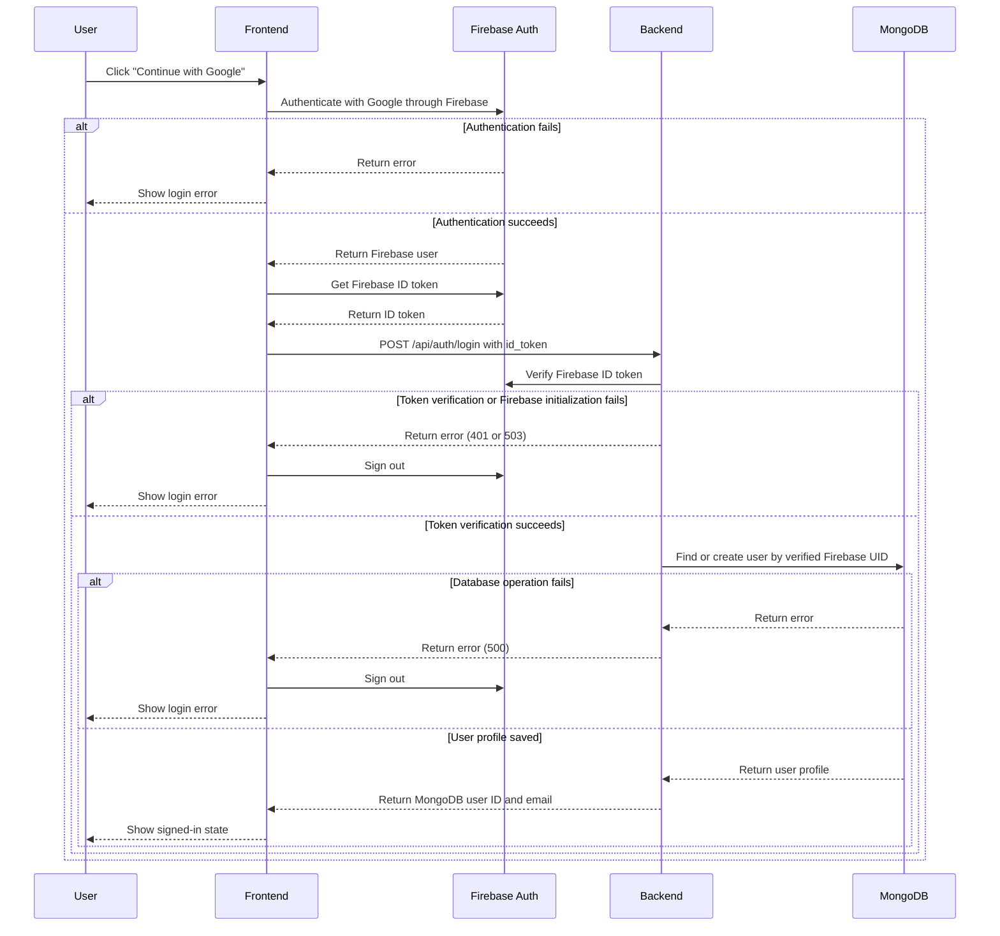
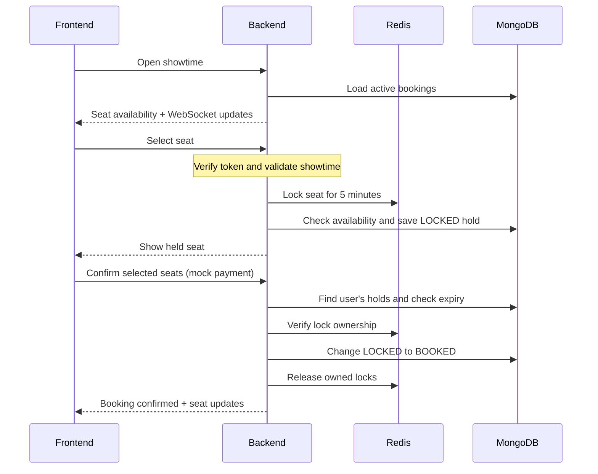
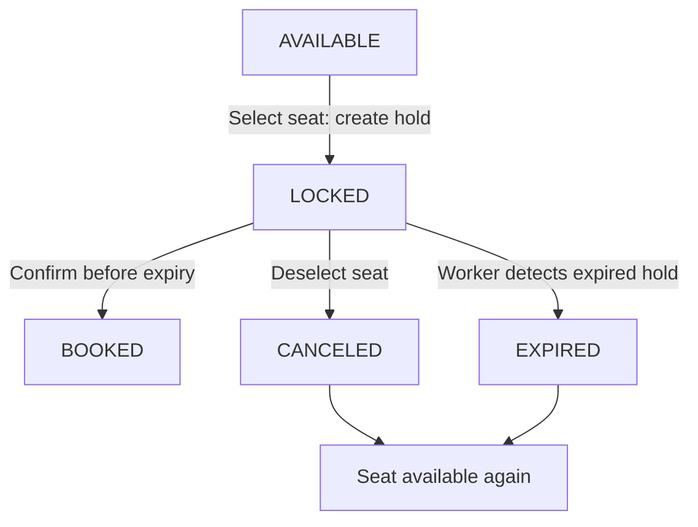

# Cinema Ticket Booking System

This demo showcases the core features of the cinema ticket booking system, including seat reservation, expiration handling, and audit logging.

## Tech Stack

- Backend
  - Language: Go
  - Framework: Gin
  - Database: MongoDB, Redis
  - Message Queue: RabbitMQ
- Frontend (Both Auth & Admin Side): Vue 3
- Auth: Firebase Auth
- Deployment: Docker

## System Architecture


- **Frontend** - Website represent UI which users can browse movies, view showtimes, and select seats for booking. Includes admin page for viewing bookings and managing the system.
- **Firebase Auth** - Authentication server connected with the frontend for user sign-in and the backend for ID token verification.
- **Backend** - REST API and Websocket servers to perform requests to create tickets and reserve seats for users
- **Audit Worker** - Background process that handles audit logging.
- **Expiration Booking Worker** - Background process that handles seat expiration and releases held seats back to availability.
- **Database** - MongoDB stores persistent data such as user data, movies, showtimes, and bookings.
- **Redis** - Used for distributed locking and publish/subscribe for expiration updates.
- **Message Queue** - RabbitMQ carries booking audit events from the API and expiration worker to the audit worker. Seat expiration runs by polling MongoDB, independently of the queue.

## Flow & Strategy

### Login

The login flow ensures that the frontend only considers the user signed in after successful backend authentication. The backend derives the UID and email from the verified Firebase ID token, creating an application profile on first login and reusing it on subsequent logins. A unique Firebase UID index prevents duplicate profiles. Booking ownership relies on the Firebase UID from verified bearer tokens.



### Booking

Users can browse seat availability without signing in. Selecting a seat requires
login and immediately creates a hold. clicking **Confirm booking** simulates
payment success and confirms all currently selected seats.

The diagrams summarize successful operations. The backend verifies a Firebase
bearer token for every hold, confirmation, and release request. Audit events and
endpoint details are described in the steps below.

#### Select and confirm seats



### Seat status and hold release



`CANCELED` and `EXPIRED` are stored booking statuses. Both appear as `AVAILABLE`
on the seat map. Deselecting releases the Redis lock immediately. For expiration,
Redis removes the lock automatically, and the worker updates MongoDB and notifies
browsers through Redis Pub/Sub and WebSocket.

1. **Sign in.** Use Google through Firebase Auth. The backend verifies bearer
   tokens and uses the Firebase UID as the booking owner.

2. **Open a showtime.** Load active bookings and connect to WebSocket for live
   seat availability.

3. **Select a seat.** `POST /api/bookings/holds` validates the seat and showtime,
   then acquires a five-minute Redis lock. Unavailable seats return `409 Conflict`.

4. **Save the hold.** Store a `LOCKED` booking in MongoDB and broadcast the update.
   If saving fails, attempt to clean up partial inserts and release the locks.

5. **Confirm the booking.** `POST /api/bookings/confirm` simulates payment success.
   Verify hold ownership and expiry, change `LOCKED` to `BOOKED`, release Redis
   locks, and publish seat updates and audit events.

6. **Release a seat.** `DELETE /api/bookings/holds` changes the user's hold to
   `CANCELED`, releases its lock, and makes the seat available again.

7. **Expire a hold.** Redis locks expire after five minutes. The worker marks
   overdue holds as `EXPIRED` and broadcasts availability updates.

8. **Record audit events.** The audit worker consumes RabbitMQ events and saves
   them to MongoDB's `booking_audit_logs` collection.

### Lock Strategy

- **Tools and rationale:** Redis coordinates temporary seat holds across backend
  instances, while a Go mutex only protects one process. Its fast, in-memory
  operations and automatic expiry suit short-lived holds without keeping a
  database transaction open while customers choose seats or pay.

- **Lock format:** `seat-lock:<showtime_id>:<seat_number>` identifies one seat in
  one screening. The prefix separates locks from other Redis data; the showtime
  and seat IDs prevent unrelated seats or screenings from blocking each other.
  For example, `seat-lock:showtime-123:A1` and `seat-lock:showtime-456:A1` are
  independent. A random token stored as the value identifies the lock owner.

- **Acquisition and release:** `SET NX` with a TTL acquires a lock atomically and
  automatically releases abandoned holds. Go invokes Lua inside Redis to check
  the ownership token and delete the lock atomically. Separate `GET` and `DEL`
  calls could delete a newer customer's lock if ownership changes between calls;
  Lua prevents this race and avoids an extra network round trip. Multi-seat
  requests acquire locks in sorted order and release acquired locks if any
  acquisition fails.

- **Persistent protection:** MongoDB stores bookings, with a unique active-seat
  index to prevent double booking. Conditional status updates protect confirmation,
  release, and expiration from competing transitions. Multi-seat confirmation
  updates each booking individually, so it can partially succeed.

### Worker Delivery Notes

- **Expiration:** Polls MongoDB every second (configurable via
  `BOOKING_EXPIRATION_INTERVAL`), rather than using Redis expiry notifications.

- **Audit:** Consumes `booking.audit` using durable queues, persistent messages,
  and publisher confirms. Acknowledges after saving, requeues insert failures,
  and rejects invalid events. No retry limit, backoff, or deduplication;
  redelivery may duplicate logs. Publish failures are logged without booking
  rollback, retry, or an outbox, so audit events may be lost.

## Setup

Create a project in the [Firebase Console](https://console.firebase.google.com/), then configure both the backend and frontend:

1. Download the private backend service account:
   - Open **Project settings** (the gear icon).
   - Select **Service accounts** and then **Firebase Admin SDK**.
   - Select **Generate new private key** and confirm the download.
   - Rename the downloaded file to `firebase_credentials.json` and place it at `backend/config/firebase_credentials.json`.

   This file contains a private key. Never commit it or expose it to browser code.

2. Register the public frontend Web App:
   - From **Project settings**, open the **General** tab.
   - Under **Your apps**, select the Web icon (`</>`). If an app already exists, select that app instead.
   - Enter an app nickname such as `cinema-ticket-booking-frontend`. Firebase Hosting is not required.
   - Select **Register app**.
   - Firebase displays a `firebaseConfig` object. Copy its `apiKey`, `authDomain`, `projectId`, `storageBucket`, `messagingSenderId`, and `appId` values into `frontend/.env`, using `frontend/.env.example` as the template.

   The Web App configuration identifies the Firebase project and is safe to include in the compiled frontend. It is separate from the private Admin service-account file.

3. Enable the authentication providers:
   - Open **Authentication**, select **Get started**, and go to **Sign-in method**.
   - Enable **Google**, select a project support email, and save.

4. Build and start the services. Docker Compose mounts
   `backend/config/firebase_credentials.json` read-only into the backend at
   `/config/firebase_credentials.json`, referenced by `GOOGLE_APPLICATION_CREDENTIALS`:

   ```sh
   docker compose up --build
   ```
