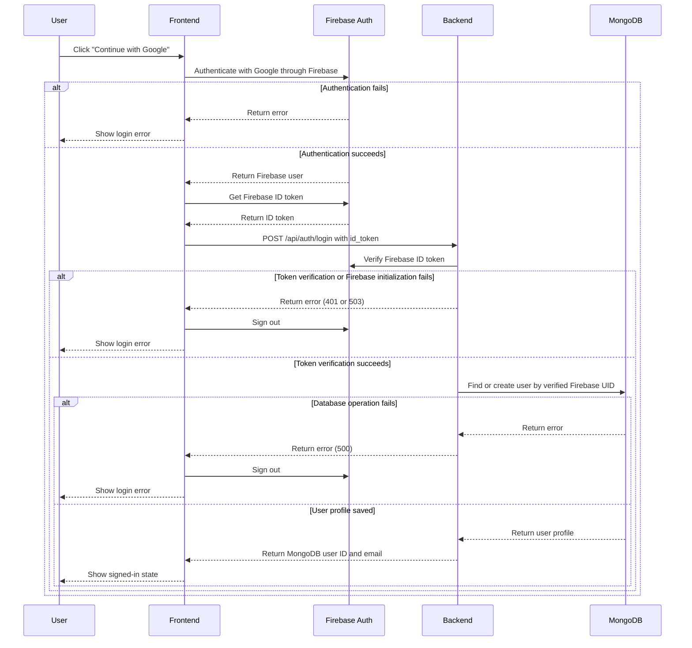
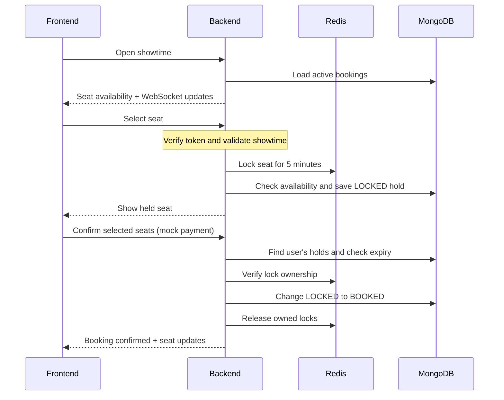
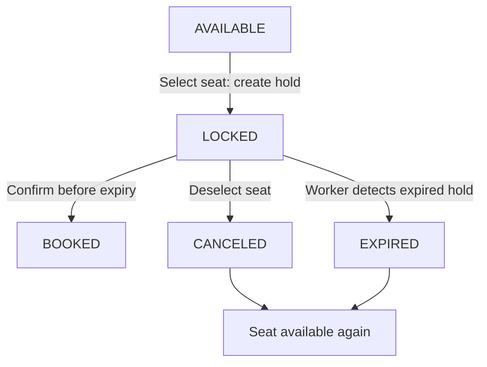

# Cinema Ticket Booking System

This demo showcases the core features of the cinema ticket booking system, including seat reservation, expiration handling, and audit logging.

## Tech Stack

- Backend
  - Language: Go
  - Framework: Gin
  - Database: MongoDB, Redis
  - Message Queue: RabbitMQ
- Frontend (Both Auth & Admin Side): Vue 3
- Auth: Firebase Auth
- Deployment: Docker

## System Architecture




- **Frontend** - Website represent UI which users can browse movies, view showtimes, and select seats for booking.
- **Firebase Auth** - Authentication server connected with the frontend for user sign-in and the backend for ID token verification.
- **Backend** - REST API and Websocket servers to perform requests to create tickets and reserve seats for users
- **Audit Worker** - Background process that handles audit logging.
- **Expiration Booking Worker** - Background process that handles seat expiration and releases held seats back to availability.
- **Database** - MongoDB stores persistent data such as user data, movies, showtimes, and bookings.
- **Redis** - Used for distributed locking and publish/subscribe for expiration updates.
- **Message Queue** - RabbitMQ carries booking audit events from the API and expiration worker to the audit worker. Seat expiration runs by polling MongoDB, independently of the queue.

## Project Structure

- `backend/`
  - `cmd/`
    - `api/`: HTTP API and WebSocket server entrypoint.
    - `worker/`: Worker entrypoint.
  - `config/`: Configuration files and setup.
  - `internal/`
    - `database/`: Database connection and shared repository.
    - `firebase/`: Firebase Admin client setup.
    - `redis/`: Redis connection setup.
    - `event/`: Queue event types and constants.
    - `auditlog/`: Audit log models and repository.
    - `movie/`: Movie listing and details.
    - `showtime/`: Showtime listing and details.
      - `ws/`: Seat snapshots and WebSocket updates.
    - `auth/`: Login and user registration.
    - `booking/`: Seat holds, confirmation, release, and expiration.
    - `locker/`: Seat locks and ownership checks.
    - `notifier/`: Pub/Sub bridge for expiration updates.
    - `queue/`: RabbitMQ connection and event publishing.
    - `user/`: User persistence and authentication middleware.
    - `worker/`: Audit consumer, expiration loop, worker setup and runner.
  - `deployment/`: API and worker container builds.
  - `scripts/`: Database seed script.
    - `source/`: Movie and showtime seed data.
  - `go.mod`: Go dependencies.
- `frontend/`
  - `src/`
    - `api/`: HTTP client and API query/mutation functions.
    - `components/`: Shared Vue components.
    - `composables/`: Shared authentication state and actions.
    - `router/`: Vue Router configuration.
    - `views/`: Page components for different routes.
    - `styles/`: Shared styles.
    - `firebase.ts`: Firebase browser client setup.
    - `App.vue`: Application root.
    - `main.ts`: Vue application entrypoint.
  - `public/`: Static public assets.
  - `deployment/`: Frontend Dockerfile and Nginx configuration.
  - `.env`: Environment variables for the frontend.
  - `package.json`: Frontend dependencies and scripts.
- `content/`: Static files for README.
- `scripts/`: Scripts for generating the static content or global assets.
- Root files
  - `docker-compose.yml`: Local services and application containers.
  - `README.md`: Project documentation.
  - `package.json`: Project dependencies and scripts (Currently using for generating static content).


## Flow & Strategy

### Login

The login flow ensures that the frontend only considers the user signed in after successful backend authentication. The backend derives the UID and email from the verified Firebase ID token, creating an application profile on first login and reusing it on subsequent logins. A unique Firebase UID index prevents duplicate profiles. Booking ownership relies on the Firebase UID from verified bearer tokens.



### Booking

Users can browse seat availability without signing in. Selecting a seat requires
login and immediately creates a hold. clicking **Confirm booking** simulates
payment success and confirms all currently selected seats.

The diagrams summarize successful operations. The backend verifies a Firebase
bearer token for every hold, confirmation, and release request. Audit events and
endpoint details are described in the steps below.

#### Select and confirm seats



### Seat status and hold release



`CANCELED` and `EXPIRED` are stored booking statuses. Both appear as `AVAILABLE`
on the seat map. Deselecting releases the Redis lock immediately. For expiration,
Redis removes the lock automatically, and the worker updates MongoDB and notifies
browsers through Redis Pub/Sub and WebSocket.

1. **Sign in.** Use Google through Firebase Auth. The backend verifies bearer
   tokens and uses the Firebase UID as the booking owner.

2. **Open a showtime.** Load active bookings and connect to WebSocket for live
   seat availability.

3. **Select a seat.** `POST /api/bookings/holds` validates the seat and showtime,
   then acquires a five-minute Redis lock. Unavailable seats return `409 Conflict`.

4. **Save the hold.** Store a `LOCKED` booking in MongoDB and broadcast the update.
   If saving fails, attempt to clean up partial inserts and release the locks.

5. **Confirm the booking.** `POST /api/bookings/confirm` simulates payment success.
   Verify hold ownership and expiry, change `LOCKED` to `BOOKED`, release Redis
   locks, and publish seat updates and audit events.

6. **Release a seat.** `DELETE /api/bookings/holds` changes the user's hold to
   `CANCELED`, releases its lock, and makes the seat available again.

7. **Expire a hold.** Redis locks expire after five minutes. The worker marks
   overdue holds as `EXPIRED` and broadcasts availability updates.

8. **Record audit events.** The audit worker consumes RabbitMQ events and saves
   them to MongoDB's `booking_audit_logs` collection.

### Redis Lock Strategy

Redis provides a shared place to coordinate temporary seat holds across backend
instances. A Go mutex protects only one process, so it cannot coordinate requests
handled by different instances. Redis combines atomic lock acquisition with a
TTL, letting one customer hold a seat while automatically releasing the lock if
they leave or the backend crashes. Its in-memory operations suit frequent,
short-lived holds, without keeping a database transaction open while a customer
decides or completes payment. MongoDB still stores bookings and enforces the
persistent constraints; Redis handles temporary ownership.

Each Redis key is scoped to a showtime and seat:
`seat-lock:<showtime_id>:<seat_number>`. The `seat-lock` prefix distinguishes
these keys from other Redis data, and the colon separators make the parts easy
to read when debugging. The showtime ID separates reservations for different
screenings, while the seat number limits contention to one seat within that
screening. For example, `seat-lock:showtime-123:A1` and
`seat-lock:showtime-456:A1` can be held independently. Customers selecting A1
for the same showtime compete for the same key, while customers selecting A2
can proceed independently. Using only the seat number would block A1 across
unrelated showtimes; using only the showtime ID would block every seat in that
showtime. The format identifies the resource being held; the random token stored
as its value identifies the current owner.

`SET NX` lets only one request acquire a seat lock when its key does not exist,
while the TTL bounds abandoned holds. Lua scripts check ownership and delete
keys only when the token matches, so an old request cannot remove a newer user's
lock. Multi-seat requests acquire locks in sorted order and release acquired
locks if any acquisition fails.

Lua runs inside Redis, allowing the ownership check and lock deletion to execute
as one atomic operation. Separate `GET` and `DEL` calls from Go would leave a gap:
after the token check, the lock could expire and another customer could acquire
it before the original request deletes the key. The Lua script prevents that
race by allowing no other Redis commands to run between the check and deletion.
Go still handles booking requests and invokes the script; Lua handles the logic
that must run atomically inside Redis. A script call also avoids separate network
round trips for checking and deleting locks.

MongoDB is the persistent booking record. Redis coordinates temporary ownership.
The unique active-seat index provides an additional guard against double booking.
Confirmation, release, and expiration use conditional MongoDB status updates so
competing operations cannot both transition the same hold successfully.
Multi-seat confirmation updates records individually, so an error can leave part
of a selection confirmed. The operation is not an atomic transaction across seats.


### Worker Delivery Notes

The expiration worker polls MongoDB rather than listening for Redis key-expiry
notifications. Its default interval is one second and can be changed with
`BOOKING_EXPIRATION_INTERVAL` 

The audit worker consumes `booking.audit` and the legacy `booking.success` queue.
The publisher uses durable queues, persistent messages, and publisher confirms.
The worker acknowledges messages after inserting the audit log, requeues messages
when insertion fails, and rejects malformed or unknown events without requeueing.
There is no retry limit, backoff, or audit deduplication, so redelivery can create
duplicate logs. Publishing failures are logged without rolling back the booking.
There is no outbox or application retry to recover a missing audit event.

Hold, confirmation, and release updates go directly to the current API process's
WebSocket hub. Only expiration updates use Redis Pub/Sub to reach API processes.
Pub/Sub updates are not persisted or replayed after a disconnect.


## Setup

Create a project in the [Firebase Console](https://console.firebase.google.com/), then configure both the backend and frontend:

1. Download the private backend service account:
   - Open **Project settings** (the gear icon).
   - Select **Service accounts** and then **Firebase Admin SDK**.
   - Select **Generate new private key** and confirm the download.
   - Rename the downloaded file to `firebase_credentials.json` and place it at `backend/config/firebase_credentials.json`.

   This file contains a private key. Never commit it or expose it to browser code.

2. Register the public frontend Web App:
   - From **Project settings**, open the **General** tab.
   - Under **Your apps**, select the Web icon (`</>`). If an app already exists, select that app instead.
   - Enter an app nickname such as `cinema-ticket-booking-frontend`. Firebase Hosting is not required.
   - Select **Register app**.
   - Firebase displays a `firebaseConfig` object. Copy its `apiKey`, `authDomain`, `projectId`, `storageBucket`, `messagingSenderId`, and `appId` values into `frontend/.env`, using `frontend/.env.example` as the template.

   The Web App configuration identifies the Firebase project and is safe to include in the compiled frontend. It is separate from the private Admin service-account file.

3. Enable the authentication providers:
   - Open **Authentication**, select **Get started**, and go to **Sign-in method**.
   - Enable **Google**, select a project support email, and save.

4. Build and start the services. Docker Compose mounts
   `backend/config/firebase_credentials.json` read-only into the backend at
   `/config/firebase_credentials.json`, referenced by `GOOGLE_APPLICATION_CREDENTIALS`:

   ```sh
   docker compose up --build
   ```
