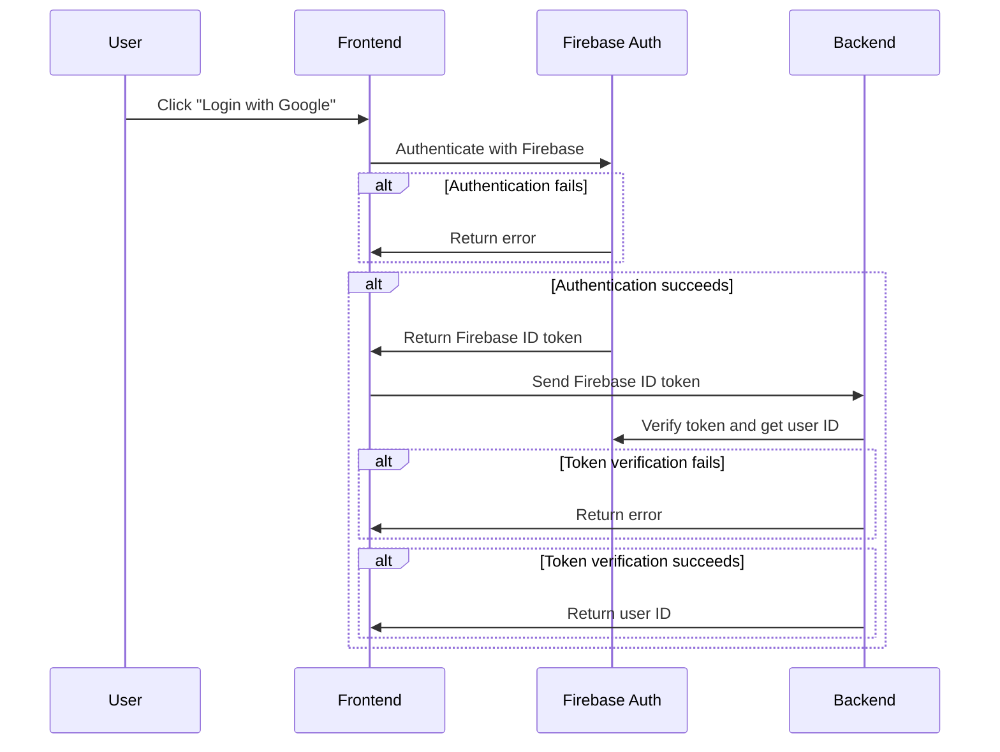
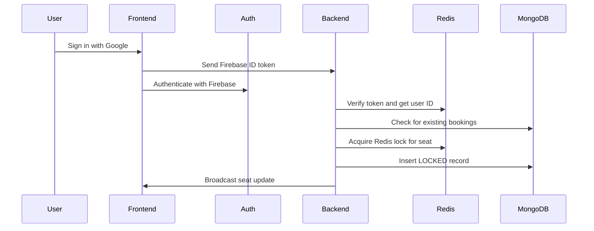

# Cinema Ticket Booking System

This demo showcases the core features of the cinema ticket booking system, including seat reservation, expiration handling, and audit logging.

## Tech Stack

- Backend
  - Language: Go
  - Framework: Gin
  - Database: MongoDB, Redis
  - Message Queue: RabbitMQ
- Frontend (Both Auth & Admin Side): Vue 3
- Auth: Firebase Auth
- Deployment: Docker

## System Architecture


- **Frontend** - Website represent UI which users can browse movies, view showtimes, and select seats for booking.
- **Firebase Auth** - Authentication server connected with the frontend for user sign-in and the backend for ID token verification.
- **Backend** - REST API and Websocket servers to perform requests to create tickets and reserve seats for users
- **Audit Worker** - Background process that handles audit logging.
- **Expiration Booking Worker** - Background process that handles seat expiration and releases held seats back to availability.
- **Database** - MongoDB stores persistent data such as user data, movies, showtimes, and bookings.
- **Redis** - Used for distributed locking and publish/subscribe for expiration updates.
- **Message Queue** - RabbitMQ handles asynchronous communication between the backend and audit worker for tasks such as logging and seat expiration.

## Project Structure

- `backend/`
  - `cmd/`
    - `api/`: HTTP API and WebSocket server entrypoint.
    - `worker/`: Worker entrypoint.
  - `config/`: Configuration files and setup.
  - `internal/`
    - `database/`: Database connection and shared repository.
    - `firebase/`: Firebase Admin client setup.
    - `redis/`: Redis connection setup.
    - `event/`: Queue event types and constants.
    - `auditlog/`: Audit log models and repository.
    - `movie/`: Movie listing and details.
    - `showtime/`: Showtime listing and details.
      - `ws/`: Seat snapshots and WebSocket updates.
    - `auth/`: Login and user registration.
    - `booking/`: Seat holds, confirmation, release, and expiration.
    - `locker/`: Seat locks and ownership checks.
    - `notifier/`: Pub/Sub bridge for expiration updates.
    - `queue/`: RabbitMQ connection and event publishing.
    - `user/`: User persistence and authentication middleware.
    - `worker/`: Audit consumer, expiration loop, worker setup and runner.
  - `deployment/`: API and worker container builds.
  - `scripts/`: Database seed script.
    - `source/`: Movie and showtime seed data.
  - `go.mod`: Go dependencies.
- `frontend/`
  - `src/`
    - `api/`: HTTP client and API query/mutation functions.
    - `components/`: Shared Vue components.
    - `composables/`: Shared authentication state and actions.
    - `router/`: Vue Router configuration.
    - `views/`: Page components for different routes.
    - `styles/`: Shared styles.
    - `firebase.ts`: Firebase browser client setup.
    - `App.vue`: Application root.
    - `main.ts`: Vue application entrypoint.
  - `public/`: Static public assets.
  - `deployment/`: Frontend Dockerfile and Nginx configuration.
  - `.env`: Environment variables for the frontend.
  - `package.json`: Frontend dependencies and scripts.
- `content/`: Static files for README.
- `scripts/`: Scripts for generating the static content or global assets.
- Root files
  - `docker-compose.yml`: Local services and application containers.
  - `README.md`: Project documentation.
  - `package.json`: Project dependencies and scripts (Currently using for generating static content).


## Flow & Strategy

### Login




## Booking





1. **Sign in.** The user signs in with Google through Firebase Auth. Seat-hold,
   confirmation, and release requests send the Firebase ID token as
   `Authorization: Bearer <token>`. The backend verifies the token and takes the
   booking owner from its Firebase UID, rather than trusting a user ID in the request.

2. **Open a showtime.** The frontend loads its bookings with
   `GET /api/bookings?show_time_id=<id>` and connects to
   `/ws/showtimes/<id>`. The WebSocket sends an initial seat snapshot and subsequent
   updates. Seats appear as `AVAILABLE`, `LOCKED`, or `BOOKED`.

3. **Select a seat.** The frontend calls `POST /api/bookings/holds` with
   `show_time_id` and `seat_numbers`. The backend validates the seat numbers and
   checks that the showtime exists and has not started. It acquires a Redis lock
   for each seat using `SET NX` with a unique ownership token and a five-minute TTL.
   If any lock cannot be acquired, locks already acquired by that request are
   released and the request fails. Seat contention returns HTTP `409 Conflict`.

4. **Save the hold.** After acquiring Redis locks, the backend checks MongoDB for
   existing active bookings and inserts `LOCKED` records with their ownership token
   and expiration time. A unique partial index on showtime and seat prevents
   multiple active bookings for the same seat. If persistence fails, the backend
   attempts to remove partial inserts and releases the request's Redis locks.
   Successful holds are broadcast through the API's WebSocket hub.

5. **Confirm the booking.** The frontend calls `POST /api/bookings/confirm` with
   the showtime and selected seats. This is the mock payment-success action; there
   is no payment gateway. The backend checks that the user owns every requested
   hold, that the holds have not expired, and that their Redis tokens still match.
   It conditionally changes each MongoDB record from `LOCKED` to `BOOKED`, clears
   its hold metadata, broadcasts the update, publishes `BOOKING_SUCCESS` to
   RabbitMQ, and releases the Redis lock. The MongoDB booking continues to prevent
   another user from booking that seat after the Redis key is removed.

6. **Release a selected seat.** Deselecting a seat calls
   `DELETE /api/bookings/holds` with the same request fields. The backend checks
   ownership, conditionally changes `LOCKED` to `CANCELED`, clears hold metadata,
   broadcasts `AVAILABLE`, publishes `SEAT_RELEASED`, and releases the Redis lock.
   This endpoint releases holds; it does not cancel confirmed bookings.

7. **Expire an unpaid hold.** Redis automatically expires its lock after five
   minutes. The expiration worker checks MongoDB immediately at startup and then
   every second by default. It conditionally changes overdue `LOCKED` records to
   `EXPIRED`, clears hold metadata, and publishes `BOOKING_TIMEOUT` and
   `SEAT_RELEASED` audit events. Redis Pub/Sub forwards the seat update to API
   WebSocket hubs so connected browsers see `AVAILABLE`. A seat can remain
   unavailable briefly after Redis expiry until the worker updates MongoDB.

8. **Record audit events.** The audit worker consumes the `booking.audit` RabbitMQ
   queue and stores events in MongoDB's `booking_audit_logs` collection. Lock
   acquisition failures and instrumented persistence/lock errors also publish
   `SYSTEM_ERROR`. See the worker section below for delivery and retry limitations.

### Redis Lock Strategy

Each Redis key is scoped to a showtime and seat:
`seat-lock:<showtime_id>:<seat_number>`. `SET NX` lets only one request acquire an
existing seat lock, while the TTL bounds abandoned holds. A random token identifies
its owner. Lua scripts check ownership and delete keys only when the token matches,
so an old request cannot remove a newer user's lock. Multi-seat requests acquire
locks in sorted order and release acquired locks if any acquisition fails.

MongoDB is the persistent booking record; Redis coordinates temporary ownership.
The unique active-seat index provides an additional guard against double booking.
Confirmation, release, and expiration use conditional MongoDB status updates so
competing operations cannot both transition the same hold successfully.
Multi-seat confirmation updates records individually, so an error can leave part
of a selection confirmed; the operation is not an atomic transaction across seats.


## Setup

Create a project in the [Firebase Console](https://console.firebase.google.com/), then configure both the backend and frontend:

1. Download the private backend service account:
   - Open **Project settings** (the gear icon).
   - Select **Service accounts** and then **Firebase Admin SDK**.
   - Select **Generate new private key** and confirm the download.
   - Rename the downloaded file to `firebase_credentials.json` and place it at `backend/config/firebase_credentials.json`.

   This file contains a private key. Never commit it or expose it to browser code.

2. Register the public frontend Web App:
   - From **Project settings**, open the **General** tab.
   - Under **Your apps**, select the Web icon (`</>`). If an app already exists, select that app instead.
   - Enter an app nickname such as `cinema-ticket-booking-frontend`. Firebase Hosting is not required.
   - Select **Register app**.
   - Firebase displays a `firebaseConfig` object. Copy its `apiKey`, `authDomain`, `projectId`, `storageBucket`, `messagingSenderId`, and `appId` values into `frontend/.env`, using `frontend/.env.example` as the template.

   The Web App configuration identifies the Firebase project and is safe to include in the compiled frontend. It is separate from the private Admin service-account file.

3. Enable the authentication providers:
   - Open **Authentication**, select **Get started**, and go to **Sign-in method**.
   - Enable **Google**, select a project support email, and save.

4. Build and start the services. Docker Compose mounts the root `config` directory and each application service copies it into its own `/config` directory before startup:

   ```sh
   docker compose up --build
   ```
